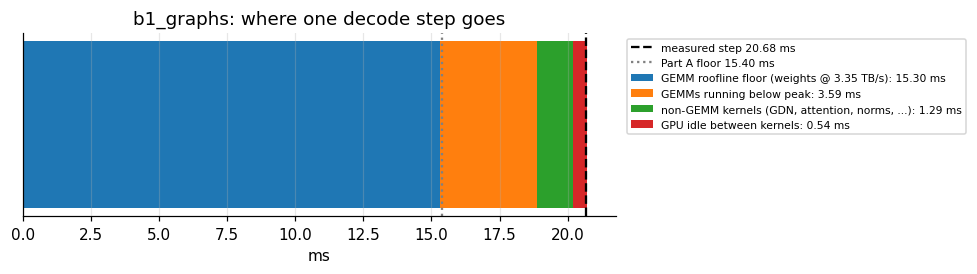

# Study: Qwen3.8-27B on vLLM, one NVIDIA H100

The first study behind the SillyBench series. Model `Qwen/Qwen3.8-27B` (dense hybrid: 48 Gated-DeltaNet linear-attention layers + 16 full-attention layers), served by **vLLM 0.31**, on one **NVIDIA H100 80GB (GCP `a3-highgpu-1g`, Spot)**, profiled with **Nsight Systems** and **Nsight Compute**.

Runs: [`runs/2026-10-09_qwen3.8-27b_bf16_initial/`](../../runs/2026-10-09_qwen3.8-27b_bf16_initial/) (the original study, used by the posts) and [`runs/2026-10-13_qwen3.8-27b_bf16_repro/`](../../runs/2026-10-13_qwen3.8-27b_bf16_repro/) (full reproduction from a fresh VM, incl. `env/` and `ncu/`). Analysis: [`notebooks/02_prediction_nsys_analysis.ipynb`](../../notebooks/02_prediction_nsys_analysis.ipynb).

## Results so far (run `2026-10-09_qwen3.8-27b_bf16_initial`)

Batch-1 decode takes **20.7 ms per token, 1.34x the 15.4 ms bandwidth floor**. The waterfall below accounts for the whole step:

| Finding | Number | Source |
|---|---|---|
| Bytes decode must read per token (GEMM weights, from `config.json`) | 51.2 GB (the 2.5 GB input embedding table is loaded but not streamed) | predicted |
| Decode floor at 3.35 TB/s, batch 1 | 15.4 ms (compute side 0.05 ms; intensity ~1 FLOP/byte vs ridge 295) | predicted |
| Decode step, batch 1 | 20.7 ms median, 1.4% step-to-step variation | measured (nsys) |
| GEMM share of decode GPU time | 94%; big GEMMs stream weights at 2.76–2.89 TB/s (82–86% of spec) | measured time + modeled bytes |
| GPU busy during decode (graphs) | 97.4%: vLLM's async scheduling hides the ~2 ms of host work per step | measured |
| CUDA graphs vs eager, batch 1 | 20.7 vs 60.5 ms per step (2.9x); GEMM times identical, GPU busy 97% vs 38% | measured |
| Prefill, 512 tokens, batch 1 | 45 ms GPU time (~59% of BF16 peak on GEMM FLOPs); GPU only 82% busy (piecewise graphs launch GDN/attention ops eagerly) | measured |
| Prefill, 32 x 512 tokens | 1.28 s GPU time, ~66% of BF16 peak | measured |
| Worst GEMM | `gdn.in_proj_ba` (5120→96): 4.7 µs for 1 MB = 0.2 TB/s, latency-bound | measured |
| Hybrid-model surprise | At batch 32 the GDN recurrent-state kernel costs **3.2 ms/step**: ~200 MB of FP32 state read+written per call at ~3 TB/s | measured time + modeled bytes |
| Concurrency limit | `max_num_seqs` is capped by ~358 GDN state blocks, not by the 223K-token KV cache | vLLM error message |
| Open question 1 | Effective bandwidth holds at ~75% of peak up to batch 64, then drops to ~49% at batch 128 (59 ms/step vs 29 ms predicted) | measured (bench) |
| Open question 2 | The first `max_tokens=1` call spent ~185 ms on the host (GPU busy 45 ms). The new `prof_run.py` also warms up `max_tokens=1` to test whether it's a first-call cost | measured |

All tables and figures: [`runs/2026-10-09_qwen3.8-27b_bf16_initial/analysis/`](../../runs/2026-10-09_qwen3.8-27b_bf16_initial/analysis/) · auto-written summary: [`findings.md`](../../runs/2026-10-09_qwen3.8-27b_bf16_initial/analysis/findings.md) · next ncu targets: [`ncu_plan/`](../../runs/2026-10-09_qwen3.8-27b_bf16_initial/ncu_plan/).

---

## Reproduced from scratch (run `2026-10-13_qwen3.8-27b_bf16_repro`)

The setup notebook was run end to end on a **brand-new** Spot VM (fresh image, fresh install, model downloaded) with the same pinned versions, then notebook 02 on the result. Decode latency matches the original run within 0.6% at every batch size:

| Batch | Original ms/step | Reproduced ms/step | Diff | Tokens/s (repro) |
|---:|---:|---:|---:|---:|
| 1   | 20.55 | 20.54 | -0.1% | 49 |
| 8   | 21.94 | 21.97 | +0.1% | 364 |
| 32  | 25.19 | 25.10 | -0.4% | 1,275 |
| 64  | 29.67 | 29.70 | +0.1% | 2,155 |
| 128 | 59.46 | 59.12 | -0.6% | 2,165 |
| 256 | 97.82 | 97.90 | +0.1% | 2,615 |

The environment capture now records the GPU's own attributes, and notebook 02 derives the peaks from them: 132 SMs, 2619 MHz x 5120-bit HBM3 = **3.35 TB/s**, 132 x 4096 FLOP/clk x 1.83 GHz = **989 BF16 TFLOP/s** (NVIDIA quotes tensor peaks at 1.83 GHz; the driver's 1.98 GHz max is the non-tensor clock), 50 MiB L2. Loaded weights (50.22 GiB) come from the run's vLLM logs.

### Nsight Compute (session 2 of the reproduction)
18 targeted deep dives (`--set full`, 3 steady-state decode instances each) plus a metric sweep of every kernel in prefill + 7 decode steps at B=1 and B=32. Reports and CSVs: [`runs/2026-10-13_qwen3.8-27b_bf16_repro/ncu/`](../../runs/2026-10-13_qwen3.8-27b_bf16_repro/ncu/); the two ~1 GB sweep reports are [release assets](https://github.com/tgarg01/SillyBench/releases/tag/ncu-2026-10-14).

| Kernel (role) | B | Time | DRAM read | Achieved read BW | Grid (CTAs) |
|---|---:|---:|---:|---:|---:|
| `mlp.gate_up` GEMM | 1 | 129.2 µs | 356.6 MB | 2.76 TB/s (82%) | 92 |
| `mlp.down` GEMM | 1 | 67.5 µs | 178.3 MB | 2.64 TB/s | 120 |
| `gdn.in_proj_qkvz` GEMM | 1 | 62.2 µs | 167.8 MB | 2.70 TB/s | 128 |
| `attn.o_proj + gdn.out_proj` GEMM | 1 | 26.6 µs | 63.0 MB | 2.37 TB/s | 80 |
| `gdn.in_proj_ba` GEMM | 1 | 6.1 µs | 1.0 MB | 0.17 TB/s | **6** |
| RMSNorm (fused add) | 1 | 4.6–4.8 µs | <0.1 MB | — | **1** |
| `mlp.gate_up` GEMM | 32 | 130.9 µs | 356.9 MB | 2.73 TB/s | 92 |
| GDN recurrent state update | 32 | 69.4 µs | 101.4 MB | 1.46 TB/s (reads only) | 6144 |
| Full attention (FA3) | 32 | 33.9 µs | 68.0 MB | 2.01 TB/s | 132 |

* The big GEMMs stream weights at 2.6–2.8 TB/s, confirming the nsys-based estimate (82–86% of peak); B=32 costs the same time as B=1 (weights dominate).
* `gdn.in_proj_ba` runs on 6 CTAs and the two RMSNorm kernels on **1 CTA** each: ~0.5 ms per decode step at B=1 (48 + 96 calls) spent in kernels that use at most 6 of 132 SMs. Candidates for fusion.
* At B=32 the GDN recurrent kernel reads ~100 MB per call (FP32 state), the hybrid-model cost found with nsys.

## GCP quotas this study needed
`Preemptible NVIDIA H100 GPUs` (your region) ≥ 1 · `GPUs (all regions)` ≥ 1 · `CPUs (all regions)` ≥ 26 · `SSD total GB` (your region) ≥ 240 free. New projects start at 0; request them in Console → IAM & Admin → Quotas (details in [docs/manual_runbook.md](../../docs/manual_runbook.md#1-gcp-project-and-quotas)).
The 240 GB boot disk counts against `SSD total GB` (default 250 per region) even while the VM is stopped, so a second VM in the same region needs a quota increase. Newer projects don't list the H100 quota in the legacy quota API that the setup notebook reads; the preflight cell then shows `??` for it, and you check it in the Console instead.

The Nsight Compute plan (session 2) took ~2 h: two whole-range metric sweeps (~30 min each, application replay) and ~18 targeted deep dives (~2 min each). For an FP8 variant of this study: set `"model": "Qwen/Qwen3.8-27B-FP8"`, `RUN_TAG = "fp8"`, run the setup notebook, then set `DTYPE_BYTES = 1` in notebook 02.

## Key concepts
| Term | Meaning here |
|---|---|
| CUDA graphs vs eager | Same kernels; graphs replay a whole decode step with one `cudaGraphLaunch`, eager launches ~2,500 kernels from Python (and in vLLM also loses torch.compile fusion). 2.9x slower at batch 1. Production uses graphs; eager is only a diagnostic baseline. |
| FULL vs PIECEWISE graphs | vLLM runs pure decode as one full graph; prefill runs as graph pieces with GDN/attention launched eagerly in between, leaving ~10 µs launch gaps. |
| Async scheduling | The CPU prepares and launches step N+1 while the GPU runs step N, so host time doesn't add to step time (the trace shows two graph launches before the first sync). |
| `nvjet_sm90_tst_384x8_..._splitK` | cuBLAS Hopper GEMM; `x8` = one token padded to 8 rows (skinny decode GEMM); `splitK` = reduction split across SMs to fill 132 SMs. |
| Default stream 7 | The software queue holding 99.9% of work; decode is one dependent kernel chain, so extra streams wouldn't help. |
| `sem_wait` under `cudaEventSynchronize` | The CPU sleeping until the GPU finishes a step. Good when the GPU is busy; a problem when both wait. |

## Pitfalls hit and fixed
| Symptom | Cause | Fix (already in the scripts/notebooks) |
|---|---|---|
| VM create fails on quota | New projects start at 0 | Request the quotas above |
| `Quota 'SSD_TOTAL_GB' exceeded. Limit: 250.0` | Another VM's 240 GB disk in the region (stopped VMs keep their disk) | Delete the old VM, or raise `SSD total GB` |
| `max_num_seqs (1024) exceeds available Mamba cache blocks (358)` | GDN state per sequence | `max_num_seqs=256` |
| `cannot execute 'cc1plus'` (FlashInfer JIT) | Image has no g++ | `vm_setup.sh` installs `build-essential` |
| ncu ~1 kernel per minute | GPU memory full (replay save/restore) + many sections | `gmu=0.72`, metric-only sweep, targeted deep dives |
| `stop` fails: Local SSD | `a3-highgpu-1g` has a Local SSD | `--discard-local-ssd=true` |
| SSH "closed by remote host" | Spot preemption | auto-resume in the setup notebook |
| Kernels named `device_kernel` | CUTLASS short names are generic | notebook 02 uses the demangled name |
| Pastes show `00~` / `01~` in macOS Terminal | bash 3.2 bracketed paste | `printf '\e[?2004l'` or use zsh |
| ncu sweep ~1 kernel/min, "Backing up device memory in system memory" | Kernel replay saves/restores ~57 GB per kernel pass through host RAM | Sweeps use `--replay-mode application` (~30 min for ~8,000 kernels) |
| Every ncu run: `prof_run.py: error: unrecognized arguments: -o ... -f` | ncu options placed after the application | Generator puts `-o`/`-f` before the app |
| B=32 GEMM deep dives: `No kernels were profiled` | At ncu's `gpu_memory_utilization=0.72` only ~24 GDN states fit, so decode ran at batch 24 (`x24` kernels) | Batch>1 profiles use the production 0.92; a run with no report now counts as failed |
| VM kept billing after a failed stage | The failing cell stopped "Run All" before the Shut down cell | `ON_FAILURE = "stop"` pulls logs and stops the VM |

## Versions (initial run)
vLLM 0.31.0 · PyTorch 2.13.0+cu130 · driver 580.178.04 (CUDA 13.0) · CUDA toolkit 12.9 · Nsight Systems 2025.1.3 · Nsight Compute 2025.2.0 · FlashInfer 0.7.0.post1 · image `common-cu129-ubuntu-2204-nvidia-580`.

## Verified end to end (2026-10-13/14)
Run for real on GCP from the setup notebook: VM create (fresh) / start / stop / delete, idempotent setup on a fresh image (16 min, mostly the vLLM install and model download), environment capture, the 12-item bench sweep (27 min), all nsys captures incl. `--gpu-metrics-devices` (6 min), the full ncu plan (`--graph-profiling node` + `--launch-skip`, `--kernel-name-base demangled`, application-replay sweeps; 70 min), sha256-verified transfer (140/140 files), and notebook 02 on the pulled run. `tests/run_offline_test.sh` passes (simulated VM, injected preemption). Spot preemption was not hit on the real VM.

The test sessions ended with `FINAL_ACTION="delete"` only to leave the project empty afterwards; the normal workflow is `stop`. GPU time for the whole verification: ~4.7 h of a3-highgpu-1g Spot (~$31 at $6.57/h), including debugging the ncu plan.
